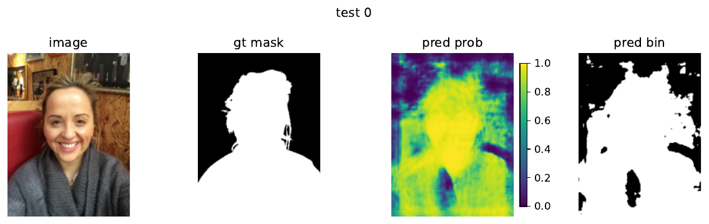

# U-Net for Binary Segmentation of People

University deep-learning coursework on segmenting **people in ordinary photographs**. The project implements a U-Net-style model with a pretrained VGG13 encoder and compares binary cross-entropy (BCE), soft Dice loss, and an equally weighted BCE + Dice loss. This is a computer-vision assignment, not medical image segmentation.

## Data and model

The [course-provided people-photo dataset](https://disk.yandex.ru/d/tI6d3LBMHTwOnw) is expected under `people_data/` with `train/`, `train_mask/`, `test/`, and `test_mask/` directories. Images and masks have matching stems; masks are converted to binary targets. The notebook makes an 80/20 train/validation split of the supplied training set using `random_state=42`; the provided test set is held out. Dataset files are not committed.

The model uses the first three VGG13 convolution blocks with pretrained torchvision weights, two custom upsampling decoder blocks with skip concatenations, and a final 1×1 convolution for one logit per pixel. Data transforms include synchronized horizontal flip, image cutout, brightness changes, and background replacement using the person mask. RGB inputs use ImageNet normalization. The custom dataset, transforms, decoder, Dice loss and evaluation loops are in the notebook. The assignment also mentions LinkNet, but no LinkNet model was implemented or evaluated here.

## Experiments and saved results

All three recorded runs use Adam (`lr=1e-4`), batch size 8, five epochs, and select the checkpoint with the best validation IoU. The notebook reports mean test metrics by averaging batch metrics. **IoU** thresholds logits at zero; **Dice coefficient** uses sigmoid probabilities (soft Dice), so the two metrics have different definitions.

| Training loss | Test IoU | Test soft Dice |
| --- | ---: | ---: |
| BCE with logits | **0.8166** | 0.8239 |
| Dice loss | 0.8073 | 0.8874 |
| 0.5 BCE + 0.5 Dice | 0.8074 | 0.8385 |

These values are transcribed from the saved output of the **original** notebook, [`original/dl2-hw3.ipynb`](original/dl2-hw3.ipynb). The original incorrectly logged `num_blocks_unet=4` while constructing a three-block model. It also reported `test_loss (Dice): 2.1893`, but that value was actually computed with `BCEWithLogitsLoss`. The revised [`unet_people.ipynb`](unet_people.ipynb) fixes the configuration label and Dice test criterion, replaces Kaggle-specific data/checkpoint paths with local paths, and clears old outputs. The classification of the historical IoU and soft Dice values is unchanged. The revised notebook has **not** been rerun; its corrected Dice test loss has no verified numeric value.

The image below was extracted from the original BCE test visualization. It shows a test photograph, ground-truth mask, predicted probability map, and thresholded prediction. Confirm the course dataset's redistribution terms before publishing this sample.



## Reproduce

With Python 3.10-3.12, place the course dataset as above and run:

```bash
python -m venv .venv
source .venv/bin/activate
python -m pip install -r requirements.txt
export PEOPLE_DATA_PATH="$PWD/people_data"
jupyter notebook unet_people.ipynb
```

Execute the notebook in order. Torchvision downloads pretrained VGG13 weights on first use. Training outputs, TensorBoard logs and checkpoints stay local and are ignored by Git. Full retraining requires the course dataset and suitable compute; no model checkpoint was supplied with the original notebook.

## References

- [Ronneberger et al., U-Net (2015)](https://arxiv.org/abs/1505.04597)
- [Simonyan and Zisserman, VGG (2014)](https://arxiv.org/abs/1409.1556)
- [Torchvision VGG13 weights](https://pytorch.org/vision/stable/models/generated/torchvision.models.vgg13.html)

The notebook contains assignment prompts and student-completed cells. Exact line-by-line authorship cannot be established from the artifact alone. Course rules and the dataset's redistribution terms should be checked before public release.
